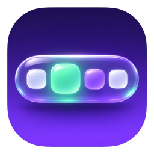

<p align="center">
  
</p>

<h1 align="center">smart-bar</h1>

<p align="center">
  A light, macOS-style dock and info bar for Windows 11, written in Rust.<br>
  <b>English</b> · <a href="#türkçe">Türkçe</a> · <a href="#deutsch">Deutsch</a>
</p>

This repository only hosts the **downloads** and the **signed update feed**. The source code lives in a private
repository.

## Download

1. Open the [latest release](../../releases/latest) and download `smart-bar-<version>.exe`.
2. Run it. It installs for your account only (no administrator rights) and starts.
3. Windows may show "Windows protected your PC" because the app is not code-signed yet: click **More info → Run anyway**.

Uninstall from **Settings → Apps → Installed apps → smart-bar**.

## Updates

smart-bar checks this repository once a day. A new version is only installed if its manifest (`latest.json`) carries a
valid signature (`latest.json.sig`, ECDSA P-256) from the release key built into the app, and the downloaded file
matches the size and SHA-256 in that manifest. You can turn automatic checks off in Settings → About.

To check a download by hand, compare it with `SHA256SUMS`:

```powershell
Get-FileHash .\smart-bar-0.9.0.exe -Algorithm SHA256
```

---

## Türkçe

Bu depo yalnızca **indirmeleri** ve **imzalı güncelleme akışını** barındırır; kaynak kod özel bir depodadır.
[Son sürümden](../../releases/latest) `smart-bar-<sürüm>.exe` dosyasını indirip çalıştırın: yalnızca sizin hesabınıza
kurulur, yönetici izni gerekmez. Windows "Bilgisayarınız korundu" derse **Ek bilgi → Yine de çalıştır**. Kaldırmak için:
Ayarlar → Uygulamalar. Güncellemeler günde bir kez denetlenir ve yalnızca imzası doğrulanırsa kurulur.

## Deutsch

Dieses Repository enthält nur die **Downloads** und den **signierten Update-Feed**; der Quellcode liegt in einem privaten
Repository. Laden Sie aus dem [neuesten Release](../../releases/latest) `smart-bar-<Version>.exe` herunter und starten Sie
es: Die Installation erfolgt nur für Ihr Konto, ohne Administratorrechte. Meldet Windows „Der Computer wurde durch
Windows geschützt“, wählen Sie **Weitere Informationen → Trotzdem ausführen**. Deinstallieren unter Einstellungen → Apps.
Updates werden einmal täglich geprüft und nur mit gültiger Signatur installiert.

<sub>Publisher: Mintdock</sub>
