

  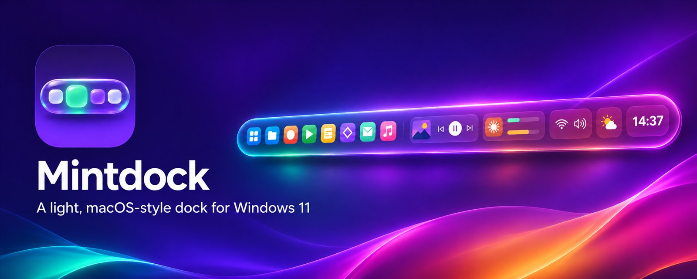

  

  
  
  
  
  

  <b>English</b> · <a href="#türkçe">Türkçe</a> · <a href="#deutsch">Deutsch</a>

**Mintdock** replaces the Windows taskbar with a floating, glassy dock: your apps on the left, live tiles for music,
weather, calendar, system and more on the right. It is a native app, so it stays light: about **15 MB of memory** and
almost no CPU while idle — no browser engine, no .NET.

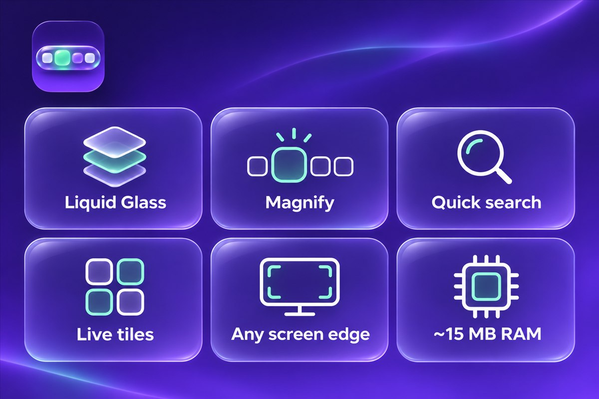

## A look inside

<table>
  <tr>
    <td width="50%">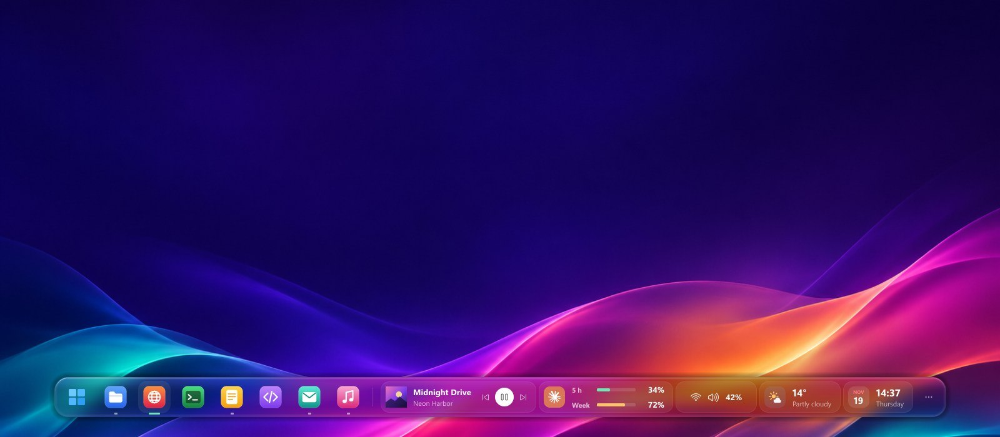 <b>Liquid Glass</b> — the dock and every panel pick up your wallpaper.</td>
    <td width="50%">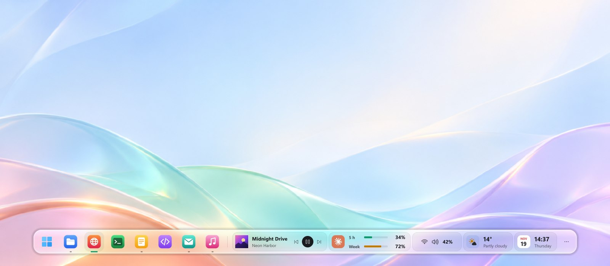 <b>Light, dark, black or midnight</b> — or follow Windows.</td>
  </tr>
  <tr>
    <td>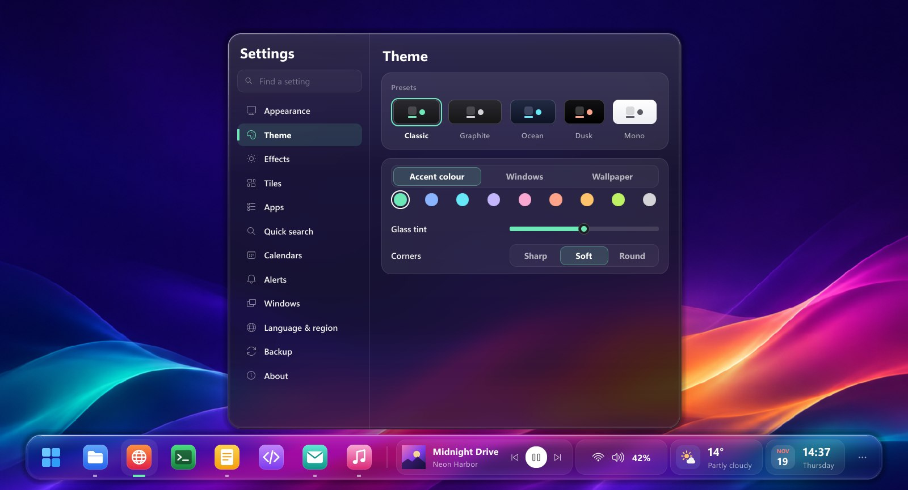 <b>Make it yours</b> — accents, presets, corners and glass tint.</td>
    <td>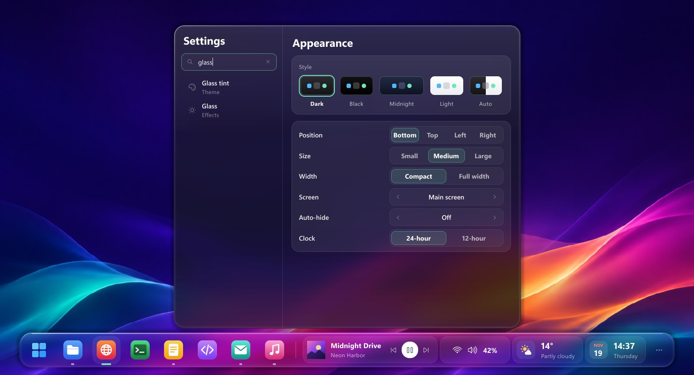 <b>Find any setting</b> by typing.</td>
  </tr>
  <tr>
    <td>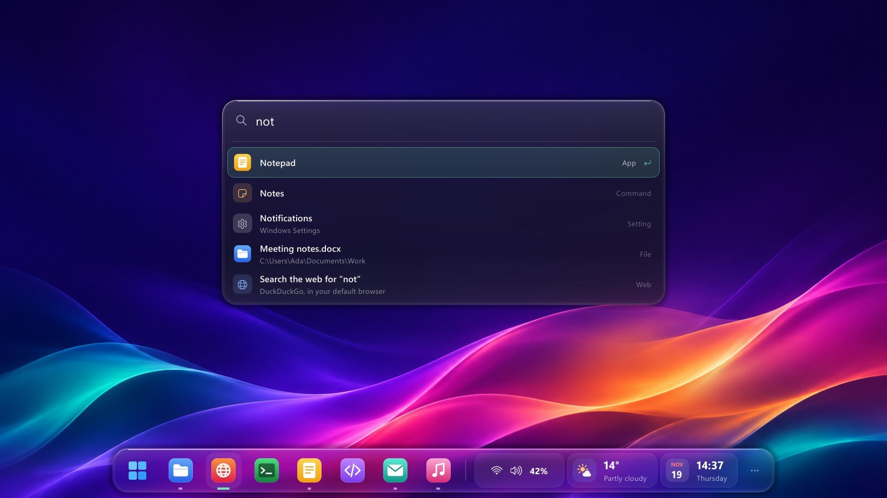 <b>Quick search</b> — apps, windows, files, settings and sums.</td>
    <td>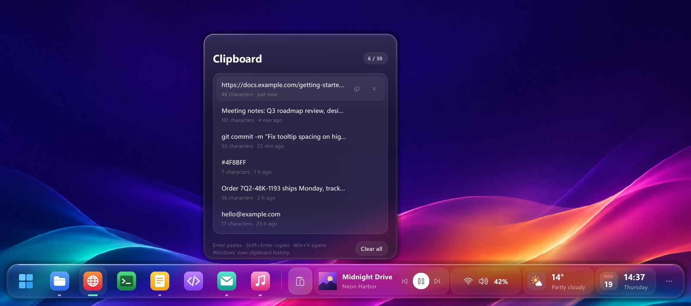 <b>Clipboard history</b> — kept in memory only, never on disk.</td>
  </tr>
  <tr>
    <td>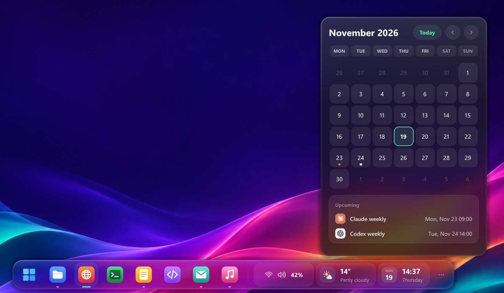 <b>Calendar</b> with your iCal events and usage reset days.</td>
    <td>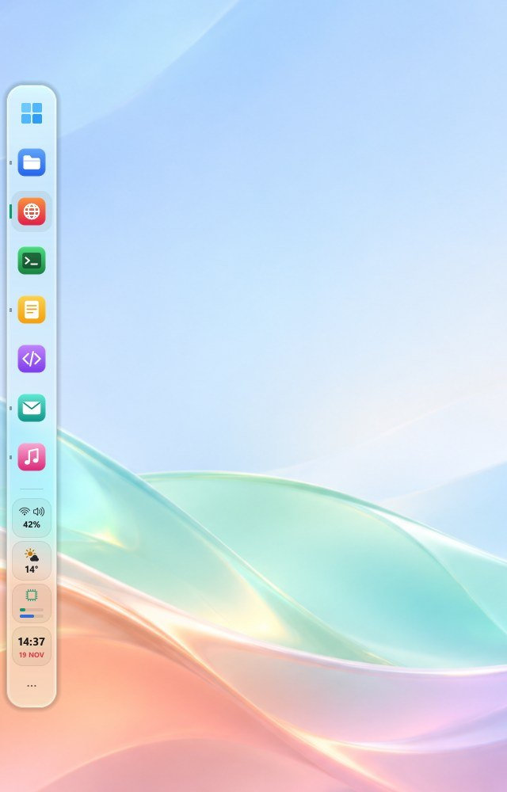 <b>Any edge, any screen</b> — bottom, top, left, right, or every monitor.</td>
  </tr>
  <tr>
    <td>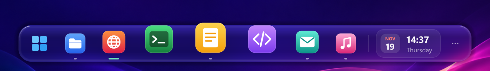 <b>Magnify</b> — icons grow under the pointer, like on a Mac.</td>
    <td>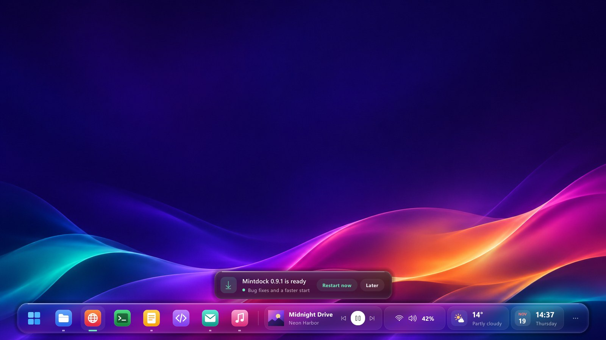 <b>Signed updates</b> — downloaded in the background, installed when you say so.</td>
  </tr>
</table>

## What you get

- **Dock:** pinned and running apps, unread badges (Discord, Outlook…), window previews, a richer right-click menu
  (jump-list tasks, recent files, run as administrator, close all windows), drag & drop, folder stacks.
- **Tiles:** clock & calendar, weather, music, network & sound, CPU & memory, storage, recycle bin, screen time, focus
  timer, notes, world clocks, Bluetooth battery, tray icons, notifications, Task Manager, clipboard.
- **Quick search** (opt-in shortcut), **window overview**, **Win+1…9**, auto-hide, hide from screen recordings.
- **Themes:** accent colours (or your Windows / wallpaper colour), presets, corners, glass tint; export and import
  your settings.
- **Three languages:** English, Türkçe, Deutsch.

## Install

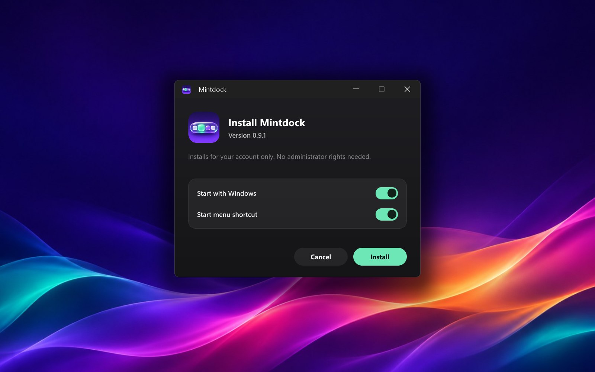

1. Download `mintdock-<version>.exe` from the [latest release](../../releases/latest).
2. Run it and click **Install**. It installs for your account only — **no administrator rights** — and starts.
3. Windows may say *"Windows protected your PC"* because the app is not code-signed yet: click **More info → Run anyway**.

**Uninstall:** Settings → Apps → Installed apps → Mintdock. Your taskbar comes back right away.

## Privacy & updates

- No account, no telemetry, no ads. Network is used only for features you turn on (weather for a city you pick, your
  calendar links, GitHub / Claude / Codex usage tiles) and the daily update check against this repository.
- Every update is checked before it is installed: the manifest `latest.json` must carry a valid ECDSA P-256 signature
  (`latest.json.sig`) from the release key built into the app, and the download must match its size and SHA-256.
- To check a download by hand: `Get-FileHash .\mintdock-<version>.exe -Algorithm SHA256` and compare with `SHA256SUMS`.

## Requirements

Windows 11, 64-bit. Nothing else to install. A GPU is only used if you turn on the glass effect.

---

## Türkçe

**Mintdock**, Windows görev çubuğunun yerine geçen, havada duran cam görünümlü bir dock: solda uygulamaların, sağda
müzik, hava durumu, takvim, sistem ve daha fazlası için canlı kutucuklar. Yerel bir uygulama olduğu için çok hafif:
boşta yaklaşık **15 MB bellek** ve neredeyse sıfır işlemci.

- **İndir:** [son sürümden](../../releases/latest) `mintdock-<sürüm>.exe` dosyasını indirip çalıştırın ve **Kur**'a basın.
  Yalnızca sizin hesabınıza kurulur, **yönetici izni gerekmez**.
- Windows *"Bilgisayarınız korundu"* derse (uygulama henüz kod imzalı değil): **Ek bilgi → Yine de çalıştır**.
- **Kaldırma:** Ayarlar → Uygulamalar → Mintdock. Görev çubuğunuz hemen geri gelir.
- **Güncellemeler** günde bir kez denetlenir, arka planda indirilir ve yalnızca imzası doğrulanırsa, siz onaylayınca
  kurulur. Hesap, takip veya reklam yoktur.

## Deutsch

**Mintdock** ersetzt die Windows-Taskleiste durch ein schwebendes Dock im Glas-Look: links Ihre Apps, rechts Live-Kacheln
für Musik, Wetter, Kalender, System und mehr. Als native App bleibt es leicht: im Leerlauf etwa **15 MB Speicher** und
kaum CPU.

- **Download:** Laden Sie aus dem [neuesten Release](../../releases/latest) `mintdock-<Version>.exe` herunter, starten Sie
  es und klicken Sie auf **Installieren**. Die Installation erfolgt nur für Ihr Konto, **ohne Administratorrechte**.
- Meldet Windows *„Der Computer wurde durch Windows geschützt“* (noch keine Code-Signatur): **Weitere Informationen →
  Trotzdem ausführen**.
- **Deinstallieren:** Einstellungen → Apps → Mintdock. Die Taskleiste ist sofort wieder da.
- **Updates** werden einmal täglich geprüft, im Hintergrund geladen und nur mit gültiger Signatur nach Ihrer Zustimmung
  installiert. Kein Konto, kein Tracking, keine Werbung.
